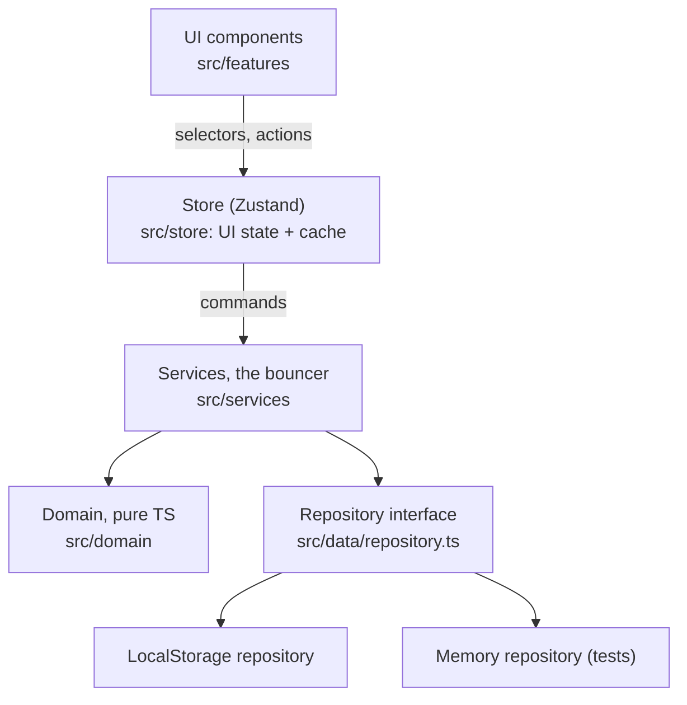

# MiniSign

A simplified document signing app in React. A sender places fields on a PDF, by hand or with Auto-prep, signs their own fields and sends it. The recipient fills in theirs, signs and finishes.

## How to run it

```
npm ci
npm run dev
```

Open the URL Vite prints. Sign-in is a dropdown: **Acting as** in the header switches between the seeded users, Dana Reyes (the demo sender), Bob Smith and Maria Lopez. **Menu → Reset demo data** asks first, then clears storage and re-seeds.

Tests: `npm test` (unit), `npm run test:e2e` (Playwright, Chromium; first run needs `npx playwright install chromium`), and `npm run verify` (typecheck, lint, unit, build, e2e).

## Architecture overview

**Data model.** Six types, in `src/domain/types.ts`:

- `User` has no role column. Sender and recipient are roles per document.
- `SourceDocument` is the blank PDF, never modified.
- `Document` is one envelope: one copy of a source going to one recipient. It holds the only stored status.
- `Field` is the layout: one placed box, page plus position. It never holds a value.
- `FieldValue` is what was filled in, keyed by `fieldId`, so a field has at most one value.
- `AuditEvent` is the append-only record, chained by hash.

Source, layout and values are separate because they change on different schedules and for different people. The blank PDF is shared by every envelope. The layout is the sender's and locks on send. Values arrive from two people at two times. Keeping them apart makes "the sender cannot edit after sending" a statement about one table, and means no value lives on a layout row.



**Where state lives.** The repository is the single source of truth. The Zustand store caches what the repository returned and holds UI-only state such as the selected field and pending suggestions. After every command the store re-reads the affected document, so a screen cannot drift from what was saved. Anything derivable, such as whether a field is editable, is computed each time and never stored.

**Folders to layers.** `src/domain` is pure rules and types. `src/data` is storage. `src/services` runs guards, writes and audit events. `src/store` is the cache. `src/features` is the screens, one folder per feature.

## Key decisions

1. **Field positions as page fractions rather than PDF points.** A field stores its page and `{x, y, w, h}` from 0 to 1. Each box is placed with percentages inside a container the size of the page, so fields follow the page at any width with no resize code. Industry tools such as DocuSign store PDF points from the page origin. The two are the same idea, anchored to the page rather than the screen, and convert by dividing by the page size. Fractions make rendering trivial. Points become the better fit once values are stamped into a real PDF, and `toPdfPoints` in `src/domain/geometry.ts` already exists for that. Layout code does its coordinate arithmetic in that module; the Auto-prep extraction adapter still does its own division by page size.

2. **`localStorage` behind an async repository, rather than in-memory state or a mock API.** State survives a refresh, which a demo of a two-person flow needs, and a mock API would add a server without adding a decision. The seam is the point: every method is async and returns copies, as a network call would, so a real API is one new class and no screen changes. The cost is a quota of roughly 5 MB, which limits uploaded PDFs to 3 MB, and atomicity only within one tab.

3. **Status rules as pure guard functions rather than XState.** `canTransition` and the permission functions are plain TypeScript. The UI calls them to disable buttons and list reasons, and the service calls them again before every write, so the UI is never the only lock. A state-machine library is overkill for two transitions, and hand-rolled guards keep the whole rule set readable in one short file.

4. **Zustand as a thin cache plus UI state, rather than Context or prop drilling.** Components read the current user, the active document and the selection through selectors. Props carry only local things, such as the field a box renders. The trade-off is one more dependency, and a store could tempt someone to treat it as the truth. Routing every write through services, then re-reading, closes that off.

5. **An append-only, hash-chained audit log as the core record.** Every `DocumentService` command appends exactly one event in the same save as the change, and each event's hash covers the previous hash. Auto-prep's accept adds fields through those same commands, then records one more event of its own. The repository has no method that edits or removes an event. The alternative, a plain activity list, could show history but could not show that history had been altered. The log is part of the core design, not the Part 2 feature: it is how the bouncer records every decision. Each document also stores the sequence number and hash of its newest event, because a bare chain cannot show that its last event was deleted. That head sits in the same storage, so it catches a deleted event, not someone who rewrites the head as well.

## My feature: Auto-prep

**What it does.** A button in the layout editor reads the PDF's own text and drawn lines, works out where fields belong, and proposes them as dashed suggestions with a guessed type, label, assignee and required flag. The sender accepts, rejects or edits each one. On the sample agreement it finds all 17 fields and nothing in the body text. I picked it because placing boxes by hand is the slowest step of preparing a new document and the one most prone to errors.

**How it plugs in.** Detectors sit behind a `FieldDetector` interface and work on a plain `PageContent` description of the page, so the core is pure and tested without a browser. One adapter is the only code that touches pdf.js for extraction. Suggestions stay UI state until accepted. Acceptance goes through the same `addField` as manual placement, so every lock and audit rule still applies, and an accepted field is an ordinary field from then on.

**Its limits.** It needs a real text layer, so a scanned PDF needs text recognition first, which would be another detector. The keyword tables are English-only. Test fixtures cover A4, legal, landscape, rotated pages, a page whose origin is not zero, an 8-column table and a PDF with no text. I also ran it on nine real government PDFs: none crashed. It found 83 boxes on the I-9, 19 on a 1040 and 19 on an SS-4, where ruled grids carry the structure. It found 2 on the W-9, whose signature line is not a ruled cell and whose captions run over several lines. It proposed 8 false boxes from an IF/THEN reference table on SS-4 page 2. It found nothing on an XFA shell form, and it does not read a PDF's existing form fields. I judged those runs from the printed positions, not by viewing each box over the rendered form.

**How it would grow.** An OCR or model detector behind the same interface, and keyword tables per organization.

**Libraries.** `react` and `vite` with strict `typescript`; `react-pdf` renders the real PDF and pdf.js supplies the text for Auto-prep; `zustand` for the store; `react-router-dom` so each document has a URL; `react-signature-canvas` for drawn signatures; `@fontsource/dancing-script` and `@fontsource-variable/schibsted-grotesk` bundle the signature and interface fonts locally, so the app makes no font network call. For development: `vitest`, Testing Library, `@playwright/test`, `pdf-lib` for the synthetic test PDF, `eslint` and `prettier`.

## How I used AI

The tools: Claude Code, with a lead agent coordinating parallel builder agents, each in its own git worktree, and an independent reviewer agent.

Generated output I did not keep as it came:

- The first version put a full label flag above every field at all times. Screenshots of the real sample showed the flags covering the document's printed captions and the values above them. It became a small tab on the box's edge, with the full flag only on hover, focus or selection.
- Two builders each wrote the outer wrapper for a field, so every field existed twice under one name. The duplicate was removed.
- A builder's first signature trimming used the library's `getTrimmedCanvas`, which threw under Vite, and was replaced with a small local function.

The full list is in `docs/ai-usage-log.md`.

When the build was done and every test passed, I didn't take that as proof it was good. I had it walk through the app as a first-time user and run Auto-prep on real government forms. That caught things the passing tests hadn't, like Reset demo data wiping everything on one click, and no way to place a field without a mouse, so I had those fixed.

The initial PRD came back saying not to spend effort on visual polish. I overrode that and made UI quality a priority, while keeping a clean seam between the UI and data access.

## What's unfinished

- Templates (saved layouts). A `TemplateField` table shaped like `Field` but keyed to the source document would plug in.
- Notifications, reminders and expiry. These would subscribe to audit events.
- A real backend, auth and email. The async repository is the seam.
- Exporting a flattened signed PDF. `toPdfPoints` plus `pdf-lib` stamping is the next step.
- Multiple recipients and signing order. The model is one recipient per document by design.
- A mobile layout. The app is desktop-first; field positions are tested at 800 px wide, but layouts below 1024 px are not designed.
- Saves are atomic within one tab only. Two tabs editing at once can overwrite each other.
- Tested in Chromium only.

Known gaps from independent review and a first-time-user walkthrough, none of which breaks the main sender and recipient flows:

- Send and Finish lock the document on one press, with no confirmation.
- The completed view has no download or print control.
- Focus falls back to the page body after Auto-prep, Accept all, Delete field, Send and Finish, and Send and Finish are not announced to a screen reader.
- On a filled form, a validation message or a focused field's flag can cover the neighbouring field.
- At 1024 px the page shrinks until the agreement is hard to read and the fields are small targets.
- After Accept all, "Signature is required" reads like a missing field when it means the signature is still to be filled in. A blocking reason clears only when the field loses focus.
- A new field defaults to the recipient, and the assignee control can sit below the fold. Delete field has no undo.
- `value.set` events record the field, not the old and new values, and saving an unchanged value appends another event.
- Zip and State are free text.
- Uploaded source documents are not scoped to the uploader, so every user can pick them on the New document screen.
- Auto-prep's audit events are written outside the service's write queue. Overlapping direct service calls can fork the chain. The app's store runs commands one at a time, so the UI does not hit this.
- Layering: `src/services/container.ts` imports from `src/features`, the layout editor imports Auto-prep directly, and `src/domain/geometry.ts` imports one React type.
- Test coverage: `AutoPrepService` has a unit test for a retried accept, not for its guards or events. Screen readers, touch and browsers other than Chromium were not tested.
